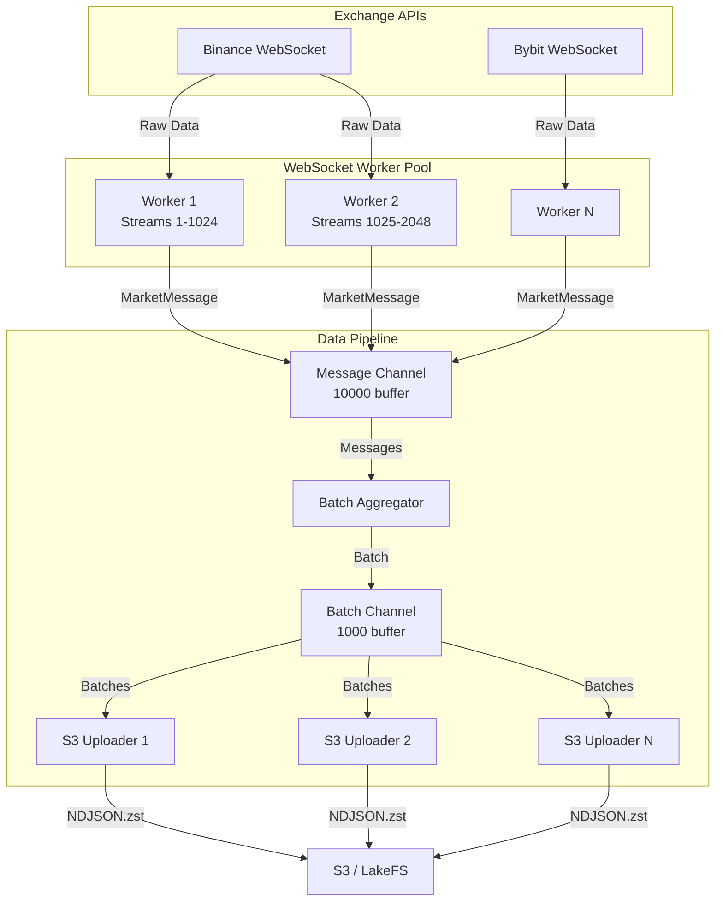
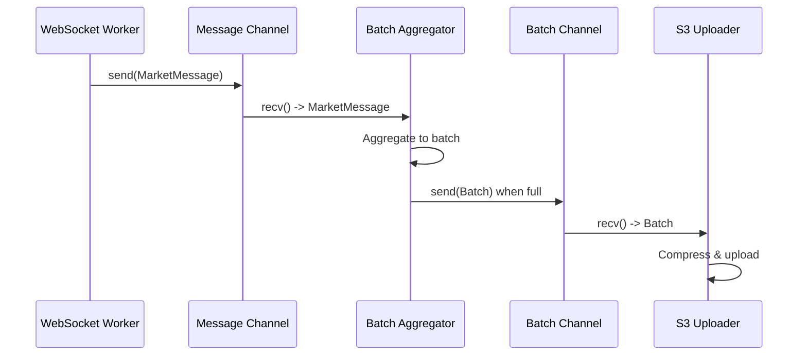
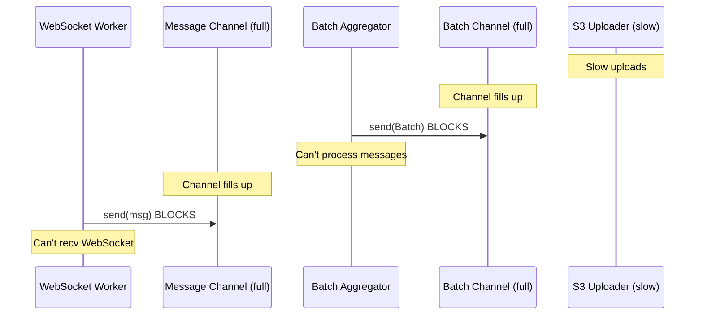

# Data Flow Architecture

## Overview

Market Chronicle uses a **stateless, memory-only buffering architecture** with direct WebSocket-to-S3 data flow. This document describes the complete data pipeline, channel communication patterns, backpressure handling, and performance considerations.

## Architecture Diagram



## Component Details

### 1. WebSocket Workers

**Responsibility**: Maintain WebSocket connections to exchanges, receive market data, parse messages.

**Key Features**:
- One worker = One WebSocket connection
- Up to 1024 streams per connection (Binance Spot)
- Up to 10 streams per connection (Bybit)
- Automatic reconnection with exponential backoff
- Heartbeat/ping-pong handling

**Message Flow**:
1. Receive raw WebSocket message
2. Parse exchange-specific format
3. Convert to normalized `MarketMessage`
4. Send to message channel

### 2. Message Channel

**Type**: `tokio::sync::mpsc::channel<MarketMessage>`

**Buffer Size**: 10,000 messages

**Purpose**: Decouple WebSocket workers from batch aggregator

**Backpressure Behavior**:
- If channel fills up, workers block on `send().await`
- Workers cannot receive new WebSocket messages while blocked
- Natural flow control without explicit rate limiting

### 3. Batch Aggregator

**Responsibility**: Group messages into batches by partition key.

**Partition Key**: `(exchange, market_type, stream_type, symbol, hour)`

**Batching Strategy**:
- **Size trigger**: Flush when batch reaches `batch_size` messages (e.g., 1000)
- **Time trigger**: Flush when batch age exceeds `batch_timeout_ms` (e.g., 5000ms)

**Implementation**:
```rust
HashMap<PartitionKey, Batch>
```

**Message Processing**:
1. Receive `MarketMessage` from channel
2. Compute partition key from message
3. Append to corresponding batch
4. Check flush conditions
5. If triggered, send batch to batch channel

### 4. Batch Channel

**Type**: `tokio::sync::mpsc::channel<Batch>`

**Buffer Size**: 1,000 batches

**Purpose**: Decouple batch aggregator from S3 uploaders

**Backpressure Behavior**:
- If S3 uploads are slow, this channel fills up
- Batch aggregator blocks on `send().await`
- Backpressure propagates to message channel

### 5. S3 Upload Workers

**Responsibility**: Compress batches and upload to S3.

**Worker Count**: Configurable (default: 4)

**Upload Process**:
1. Receive `Batch` from channel
2. Serialize messages to NDJSON
3. Compress with zstd
4. Generate UUID-based S3 key
5. Upload with Hive-style partitioning
6. Retry on failure (exponential backoff, max 5 retries)

**S3 Key Format**:
```
{prefix}/exchange={exchange}/market-type={spot|perpetual}/stream-type={type}/symbol={symbol}/year={yyyy}/month={mm}/day={dd}/hour={hh}/{uuid}.ndjson.zst
```

## Channel Communication Patterns

### Normal Operation



### Backpressure Scenario



## Performance Tuning

### Channel Buffer Sizes

**Message Channel** (default: 10,000):
- **Increase** if: Workers frequently block, high message rate
- **Decrease** if: Want tighter memory bounds
- **Calculation**: `messages_per_second * seconds_of_buffer`

**Batch Channel** (default: 1,000):
- **Increase** if: S3 uploads have high latency variance
- **Decrease** if: Want faster backpressure propagation
- **Calculation**: `batches_per_second * seconds_of_buffer`

### Batch Parameters

**Batch Size** (default: 1,000 messages):
- **Larger**: Fewer S3 uploads, better compression ratio, higher latency
- **Smaller**: Lower latency, more S3 uploads, worse compression
- **Sweet spot**: 500-2000 messages per batch

**Batch Timeout** (default: 5,000 ms):
- **Longer**: Better batching for low-volume symbols, higher latency
- **Shorter**: Lower latency, more partial batches
- **Sweet spot**: 3,000-10,000 ms

### S3 Upload Workers

**Worker Count** (default: 4):
- **More workers**: Higher upload throughput, more concurrent requests
- **Fewer workers**: Lower resource usage, simpler debugging
- **Calculation**: `target_upload_rate / upload_time_per_batch`

### Compression Level

**zstd Level** (default: 3):
- **Higher (up to 22)**: Better compression ratio, slower encoding
- **Lower (1-3)**: Faster encoding, worse compression
- **Sweet spot**: 3-5 for real-time streaming

## Performance Profiles

### Low Volume (< 100 messages/second)

```toml
[s3]
upload_worker_count = "auto"  # Will compute ~2 workers for typical low volume
batch_size = 500
batch_timeout_ms = 10000
compression_level = 5
```

Benefits: Lower latency, good compression

### Medium Volume (100-1000 messages/second)

```toml
[s3]
upload_worker_count = "auto"  # Will compute ~4-6 workers based on partitions
batch_size = 1000
batch_timeout_ms = 5000
compression_level = 3
```

Benefits: Balanced throughput and latency

### High Volume (> 1000 messages/second)

```toml
[s3]
upload_worker_count = "auto"  # Will compute up to 16 workers for high partition count
batch_size = 2000
batch_timeout_ms = 2000
compression_level = 1
```

Benefits: Maximum throughput, minimal latency

## Error Handling

### WebSocket Errors

- **Connection loss**: Automatic reconnection with exponential backoff
- **Parse errors**: Log and skip message
- **Subscription errors**: Log error, continue with existing streams

### S3 Upload Errors

- **Transient failures**: Retry with exponential backoff (max 5 attempts)
- **Permanent failures**: Log error, drop batch (data loss)
- **No retries across service restarts**: Stateless architecture

### Backpressure Handling

- **No data loss during backpressure**: Channels provide buffering
- **Workers automatically throttle**: Blocked on channel send
- **Memory bounded**: Channel sizes limit maximum memory usage

## Monitoring Recommendations

Key metrics to track:

1. **Message rate**: Messages received per second
2. **Batch rate**: Batches created per second
3. **Upload rate**: Successful uploads per second
4. **Channel fullness**: Current/max for both channels
5. **Backpressure events**: Count of blocked sends
6. **Upload latency**: Time from batch creation to S3 confirmation
7. **Worker health**: Connection status, reconnection rate

## Troubleshooting

### High Latency

**Symptoms**: Messages take long time to reach S3

**Causes**:
- Batch timeout too long
- S3 upload workers too few
- Network latency to S3

**Solutions**:
- Decrease `batch_timeout_ms`
- Increase `upload_worker_count`
- Use S3-compatible storage closer to service

### Data Loss on Crash

**Symptoms**: Missing data after service restart

**Causes**:
- Service crashed before batches uploaded
- Stateless architecture = no recovery

**Solutions**:
- Accept data loss (design tradeoff)
- Deploy multiple instances for redundancy
- Monitor service health closely

### Backpressure

**Symptoms**: Workers blocked, channels full

**Causes**:
- S3 uploads slower than message rate
- Insufficient upload workers
- S3 performance issues

**Solutions**:
- Increase `upload_worker_count`
- Increase batch channel size
- Investigate S3 performance
- Scale horizontally (more service instances)
