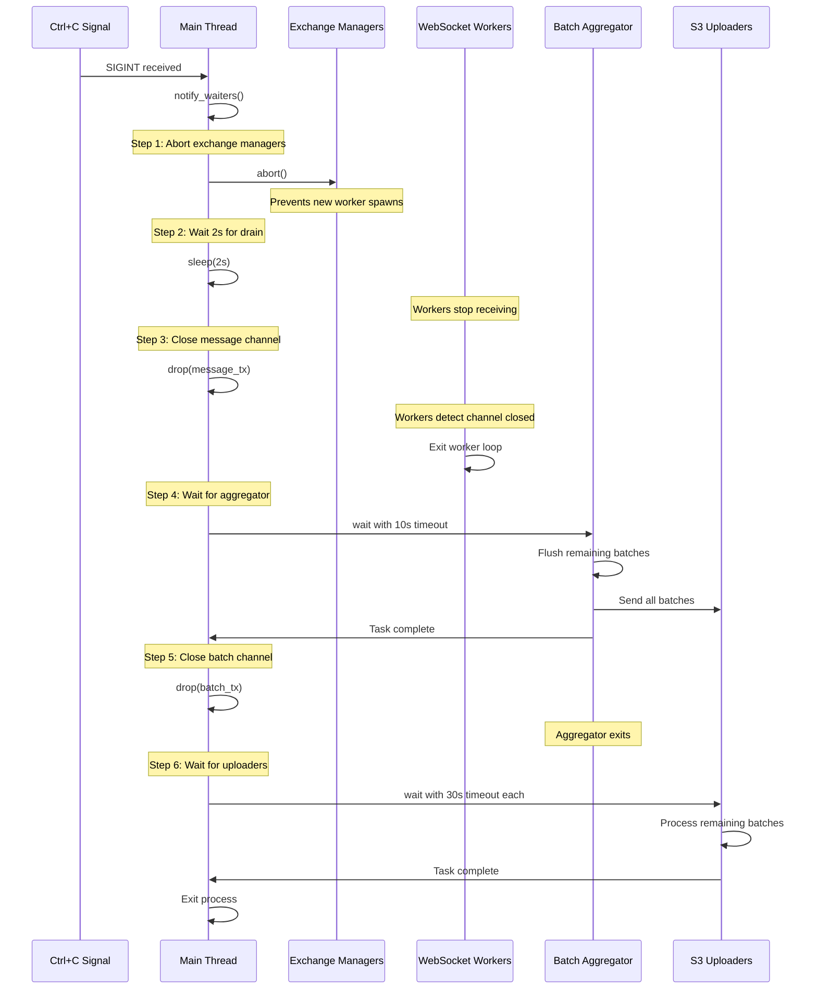

# Graceful Shutdown

## Overview

Market Chronicle implements a **coordinated shutdown sequence** to ensure data is flushed to S3 before the service terminates. This document describes the shutdown flow, implementation details, data loss scenarios, and troubleshooting.

## Shutdown Sequence



## Implementation Details

### Step 1: Abort Exchange Managers

**Purpose**: Prevent new workers from being spawned

**Code**:
```rust
for handle in exchange_handles {
    handle.abort();
}
```

**Effect**:
- Symbol managers stop
- No new WebSocket workers created
- Existing workers continue running

**Timeout**: None (immediate abort)

### Step 2: Wait for WebSocket Drain

**Purpose**: Allow in-flight messages to reach batch aggregator

**Code**:
```rust
tokio::time::sleep(Duration::from_secs(2)).await;
```

**Effect**:
- Workers continue receiving messages
- Messages flow through to batch aggregator
- Empties most in-flight data

**Timeout**: 2 seconds (fixed)

### Step 3: Close Message Channel

**Purpose**: Signal workers to stop

**Code**:
```rust
drop(message_tx);
```

**Effect**:
- Workers detect channel closed
- Workers exit their run loop
- No new messages accepted

**Channel Closure Detection**:
```rust
// In worker
if self.message_tx.send(market_msg).await.is_err() {
    break;  // Channel closed
}
```

### Step 4: Wait for Batch Aggregator

**Purpose**: Flush all remaining batches

**Code**:
```rust
match tokio::time::timeout(Duration::from_secs(10), aggregator_handle).await {
    Ok(Ok(())) => info!("Batch aggregator completed successfully"),
    Ok(Err(e)) => error!("Batch aggregator task error: {}", e),
    Err(_) => error!("Batch aggregator shutdown timed out"),
}
```

**Effect**:
- Aggregator receives `None` from message channel
- Aggregator calls `flush_all_batches()`
- All active batches sent to batch channel
- Aggregator exits

**Timeout**: 10 seconds

**Aggregator Shutdown Logic**:
```rust
msg = self.message_rx.recv() => {
    match msg {
        Some(market_msg) => {
            self.process_message(market_msg);
        }
        None => {
            // Channel closed, flush and exit
            self.flush_all_batches().await;
            break;
        }
    }
}
```

### Step 5: Close Batch Channel

**Purpose**: Signal S3 uploaders to stop

**Code**:
```rust
drop(batch_tx);
```

**Effect**:
- Uploaders detect channel closed
- Uploaders process remaining batches (with timeout)
- No new batches accepted

### Step 6: Wait for S3 Uploaders

**Purpose**: Complete all pending uploads

**Code**:
```rust
for (idx, handle) in uploader_handles.into_iter().enumerate() {
    match tokio::time::timeout(Duration::from_secs(30), handle).await {
        Ok(Ok(())) => info!(uploader_id = idx, "S3 uploader completed"),
        Ok(Err(e)) => error!(uploader_id = idx, "S3 uploader error: {}", e),
        Err(_) => error!(uploader_id = idx, "S3 uploader timeout"),
    }
}
```

**Effect**:
- Uploaders call `drain_remaining_batches(30s)`
- Uploaders compress and upload all batches
- Uploaders exit

**Timeout**: 30 seconds per uploader

**Uploader Drain Logic**:
```rust
async fn drain_remaining_batches(&mut self, timeout: Duration) {
    let deadline = Instant::now() + timeout;
    
    while Instant::now() < deadline {
        match tokio::time::timeout(Duration::from_millis(100), self.batch_rx.recv()).await {
            Ok(Some(batch)) => self.upload_batch(batch).await,
            _ => break,
        }
    }
}
```

## Data Loss Scenarios

### Scenario 1: Messages in WebSocket Buffer

**When**: Between WebSocket receive and channel send

**Likelihood**: Low (small buffer)

**Data Volume**: < 100 messages per worker

**Mitigation**: Step 2 wait period

### Scenario 2: Messages in Message Channel

**When**: Between channel and batch aggregator

**Likelihood**: Medium (depends on channel fullness)

**Data Volume**: Up to 10,000 messages

**Mitigation**: Step 4 aggregator flush

### Scenario 3: Partial Batches in Aggregator

**When**: Batches not yet full or timed out

**Likelihood**: High (always some partial batches)

**Data Volume**: `active_partitions * average_batch_size / 2`

**Mitigation**: Step 4 `flush_all_batches()`

### Scenario 4: Batches in Batch Channel

**When**: Between aggregator and uploaders

**Likelihood**: Medium (depends on upload speed)

**Data Volume**: Up to 1,000 batches

**Mitigation**: Step 6 uploader drain

### Scenario 5: Uploads in Progress

**When**: Between compression and S3 confirmation

**Likelihood**: Low (upload is usually fast)

**Data Volume**: `upload_worker_count * messages_per_batch`

**Mitigation**: Step 6 timeout allows completion

### Scenario 6: Forced Termination

**When**: SIGKILL or service crash

**Likelihood**: Low (but happens)

**Data Volume**: All data in memory

**Mitigation**: None (accept data loss)

## Timeout Tuning

### Default Timeouts

- WebSocket drain: 2 seconds
- Batch aggregator: 10 seconds
- S3 uploaders: 30 seconds each
- Total shutdown: ~45 seconds

### Increasing Timeouts

**When to increase**:
- High message rate
- Large batches
- Slow S3 performance
- Many active partitions

**How to adjust**:
```rust
// In main.rs
tokio::time::sleep(Duration::from_secs(5)).await;  // Increase drain time
tokio::time::timeout(Duration::from_secs(30), aggregator_handle).await;  // Increase aggregator timeout
self.drain_remaining_batches(Duration::from_secs(60)).await;  // Increase uploader timeout
```

### Decreasing Timeouts

**When to decrease**:
- Low message rate
- Fast restarts needed
- Acceptable data loss

**Trade-off**: Faster shutdown, more data loss

## Troubleshooting

### Symptom: Shutdown Takes Too Long

**Causes**:
- Too many partial batches
- Slow S3 uploads
- High message rate during shutdown

**Solutions**:
1. Check batch aggregator logs (how many batches flushed)
2. Check S3 uploader logs (upload times)
3. Increase timeouts if legitimate work in progress
4. Investigate S3 performance issues

### Symptom: Data Missing After Restart

**Causes**:
- Timeout expired before upload complete
- Upload failed during shutdown
- Forced termination (SIGKILL)

**Solutions**:
1. Check logs for timeout messages
2. Check logs for upload failures
3. Increase timeouts
4. Deploy multiple instances for redundancy

### Symptom: Shutdown Hangs

**Causes**:
- Aggregator or uploader task panicked
- Channel deadlock (should not happen)
- Tokio runtime issue

**Solutions**:
1. Check for panic messages in logs
2. Force kill and restart
3. File bug report with logs

### Symptom: Workers Don't Stop

**Causes**:
- Channel not closed properly
- Workers stuck in WebSocket recv
- Shutdown signal not propagated

**Solutions**:
1. Verify `drop(message_tx)` is called
2. Check worker task status
3. Ensure `shutdown.notify_waiters()` is called

## Best Practices

### 1. Monitor Shutdown Metrics

Track:
- Shutdown duration
- Messages processed during shutdown
- Batches flushed
- Uploads completed
- Timeouts hit

### 2. Test Shutdown Under Load

Regularly test:
- Shutdown during high traffic
- Shutdown with full channels
- Shutdown with slow S3

### 3. Plan for Data Loss

Remember:
- Some data loss is acceptable (design tradeoff)
- Deploy redundant instances if critical
- Monitor and alert on data gaps

### 4. Graceful Deployment

For zero data loss:
1. Deploy new instance
2. Wait for it to be healthy
3. Shutdown old instance
4. Wait for graceful shutdown to complete

### 5. Logging

Ensure logs capture:
- Shutdown initiation
- Each step completion
- Data volumes (messages, batches)
- Timeout events
- Error conditions

## Configuration Recommendations

### Production

```rust
// Longer timeouts for production reliability
const DRAIN_TIMEOUT: Duration = Duration::from_secs(5);
const AGGREGATOR_TIMEOUT: Duration = Duration::from_secs(30);
const UPLOADER_TIMEOUT: Duration = Duration::from_secs(60);
```

### Development

```rust
// Shorter timeouts for faster iteration
const DRAIN_TIMEOUT: Duration = Duration::from_secs(1);
const AGGREGATOR_TIMEOUT: Duration = Duration::from_secs(5);
const UPLOADER_TIMEOUT: Duration = Duration::from_secs(10);
```

### Testing

```rust
// Very short timeouts to test timeout handling
const DRAIN_TIMEOUT: Duration = Duration::from_millis(100);
const AGGREGATOR_TIMEOUT: Duration = Duration::from_millis(500);
const UPLOADER_TIMEOUT: Duration = Duration::from_secs(1);
```
